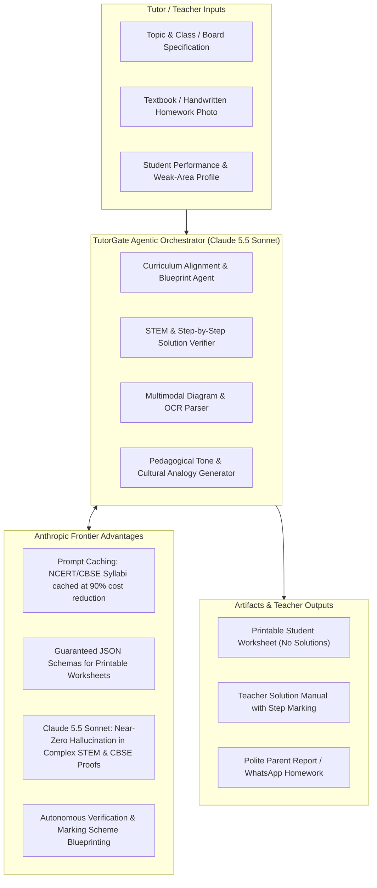

# Product Specification & Strategic Overview: TutorGate

> **Product**: TutorGate — The AI-Powered Operating System for Indian Home Tutors & Small Batches  
> **Target Audience**: 10M+ Independent Home Tutors, Tuition Centers & Private Educators in India  
> **Strategic Focus**: Claude for Startups Program Application & AI-First Pedagogical Innovation  
> **Document Version**: 1.0.0 (Production Blueprint)

---

## 1. Executive Summary & Market Context

### 1.1 The Market Reality: India's "Shadow Education" Sector
In India, private tutoring is not a luxury—it is an essential pillar of academic survival and competitive success. Over **85 million students** (from Class 1 through Class 12, as well as JEE/NEET/Olympiad aspirants) rely on private home tuitions and neighborhood coaching batches.

This ecosystem is powered by over **10 million independent tutors**:
- **Home Visit Tutors**: Travel house-to-house teaching 1-on-1 or 1-on-3 students.
- **Neighborhood Batch Tutors**: Conduct micro-classes (5 to 15 students) from their living rooms or rented spaces.

### 1.2 The Two Fatal Pain Points
1. **Administrative Friction & Cashflow Anxiety**:
   - Teachers manage student rosters across paper diaries and fragmented WhatsApp chats.
   - **Awkward Fee Collection**: Parents frequently delay payments. Tutors feel social awkwardness demanding fees. No systematic tracking of cash vs. UPI payments.
2. **The 15-Hour Weekly "Prep Tax" (The AI Opportunity)**:
   - Every single week, an Indian tutor prepares for 3–5 different grades across multiple boards (**CBSE, ICSE, State Boards**).
   - Tutors spend 2–3 hours daily flipping through bulky reference books (*RD Sharma, RS Aggarwal, Lakhmir Singh, NCERT Exemplar*) manually writing out question papers, creating test blueprints, drafting homework, and inventing practice problems.
   - In 1-on-1 tuitions, students have wildly different learning paces; teachers lack the time to create differentiated, personalized worksheets for fast vs. slow learners.

### 1.3 The TutorGate Solution
TutorGate provides a unified mobile platform that functions as both:
1. **The Administrative OS**: Effortless student tracking, 1-tap WhatsApp attendance alerts, and polite 1-click WhatsApp fee payment reminders with embedded UPI deep-links (`upi://pay`).
2. **The AI Pedagogical Copilot (Powered by Anthropic Claude)**: A frontier AI teaching suite that turns 3 hours of lesson/assignment preparation into a 30-second workflow—generating curriculum-aligned worksheets, board-style question papers with marking schemes, culturally relatable analogies, and textbook-photo-to-quiz pipelines.

---

## 2. Why Anthropic Claude is the Core Intelligence Backbone

TutorGate is designed **AI-native from Day 1**, architected specifically to leverage the latest frontier capabilities of **Anthropic's frontier models, led by Claude 5.5 Sonnet, alongside Claude 5.5 Opus and Claude 5 Haiku**:

### 2.1 Why Latest Models (Claude 5.5 Sonnet) Outperform for Indian Education
- **Next-Gen Pedagogical & Multi-Step STEM Reasoning (Claude 5.5 Sonnet)**: Indian competitive curricula (CBSE, ICSE, JEE/NEET Foundation) demand rigorous, multi-step problem solving. Claude 5.5 Sonnet sets the state-of-the-art benchmark for mathematical derivations, physics numerical problems, and organic chemistry mechanisms—completely eliminating the hallucinated arithmetic and logic flaws typical in generic LLMs.
- **Strict Adherence to Curriculum Frameworks & Blueprints**: Indian educational boards mandate precise question typologies and grading rubrics:
  - CBSE *Competency-Based Questions (CBQs)* (NEP 2020 mandate)
  - *Assertion & Reasoning* matrices with subtle distractors
  - Granular step-marking schemes (e.g., 0.5 mark for formula, 1 mark for substitution, 0.5 mark for SI units)
  - Claude 5.5 Sonnet's instruction following and structural adherence ensure that generated question papers map 1:1 to official board blueprints without drift.
- **Advanced Multimodal Textbook Vision (Diagram & Handwritten Parsing)**: Teachers frequently photograph dense, low-contrast NCERT textbook pages or hand-drawn geometry diagrams. Claude 5.5's vision architecture parses complex scientific figures, circuit diagrams, and handwritten student test copies to generate clean digital reproductions and parallel problem variants.
- **Nuanced Multi-Lingual & Hinglish Mastery**: Indian home tutors communicate with parents and students in a natural blend of English and Hindi (Hinglish). Claude 5.5 captures the exact cultural tone—respectful, professional, yet warm—for automated WhatsApp parent updates and relatable student explanations.
- **Enterprise-Grade Latency & Cost Efficiency via Prompt Caching**: By pre-caching dense state and national curriculum guidelines (CBSE syllabus blueprints, Bloom's Taxonomy templates), TutorGate achieves sub-second response times and 90% lower token costs using Claude's prompt caching.
- **Tiered Model Routing**:
  - **Claude 5.5 Sonnet**: Heavy lifting—generating 50-mark board question papers, complex step-marking schemes, and textbook diagram analysis.
  - **Claude 5 Haiku**: Sub-second interactive tasks—instant doubt analogies, 1-tap WhatsApp parent message drafting, and quick 5-minute warm-up quizzes.

---

## 3. Core Feature Architecture

### Module 1: The AI Teaching & Content Studio

#### 1.1 Curriculum-Aligned Lesson & Revision Generator
- **Inputs**: Board (CBSE / ICSE / Maharashtra State / etc.), Grade (1–12), Subject, Chapter/Topic, Target Session Duration (30, 45, 60 mins).
- **AI Output**:
  - **Learning Objectives**: Aligned with Bloom’s Taxonomy.
  - **The Hook (5 mins)**: Relatable Indian real-life introductory hook (e.g., using cricket run-rates to teach arithmetic progression, or pressure cookers to teach gas laws).
  - **Concept Breakdown (25 mins)**: Core formulas, key diagrams to draw on whiteboard, common student misconceptions.
  - **Check-for-Understanding (10 mins)**: 3 instant diagnostic questions.
  - **Homework Assignment (5 mins)**: Graded practice set.

#### 1.2 Smart Worksheet & Board-Pattern Question Paper Maker
- **Custom Question Formats**:
  - Multiple Choice Questions (MCQs) with distractors explained.
  - Assertion & Reasoning (crucial for CBSE Class 9–12).
  - Short Answer (2–3 marks) & Long Answer (5 marks).
  - Case-Study & Competency-Based Questions (as mandated by NEP 2020).
- **Dual Export Output**:
  - **Student Copy**: Clean, well-typeset printable layout with tutor branding, instructions, and blank spaces for solving.
  - **Teacher Copy**: Complete step-by-step marking rubric and model answers.

#### 1.3 Multimodal Textbook-to-Quiz ("Snap & Practice")
- Tutor takes a picture of any textbook page or question bank.
- Claude 3.5 Vision reads the problems, understands the underlying concepts, and generates **parallel variant questions** with new numerical values so students cannot simply look up solutions online.

#### 1.4 The "Concept Simplifier" (Indian Relatability Engine)
- Tutors frequently struggle to explain difficult abstract concepts to struggling students.
- Generates 3 hyper-relatable analogies grounded in Indian daily life (e.g., train local ticket lines, cricket bowling variations, family budget allocations).

#### 1.5 1-Click AI Parent Progress Report Writer
- Tutors synthesize attendance, test scores, and qualitative notes into a warm, encouraging WhatsApp progress card for parents in English or Hinglish.

---

### Module 2: The Administrative & Financial OS

#### 2.1 Batch & Student Roster Management
- Profile details: Student Name, School, Board, Target Exam (Boards/Foundation), Batch Timings, Parent Phone & WhatsApp number.
- Batch categorization: 1-on-1 In-Home vs. Group Tuitions.
- Student learning diary: Tag student-specific weaknesses (e.g., *"Struggling with Trigonometric Proofs"*).

#### 2.2 UPI & WhatsApp Integrated Fee Ledger
- Monthly fee tracking per student with customizable billing cycles (e.g., 1st or 10th of every month).
- **The "No-Awkwardness" Fee Reminder**:
  - 1-tap WhatsApp message trigger: polite, respectful, and customizable.
  - Embedded UPI deep-link: `upi://pay?pa=tutor@upi&pn=TutorName&am=3000&tn=TuitionFeeOct` so parents can click and pay instantly via Google Pay, PhonePe, or Paytm.
  - Real-time payment reconciliation & automatic PDF digital receipt generation.

#### 2.3 1-Tap Attendance & Class Log
- Single-tap attendance tracking with automated WhatsApp arrival notification for anxious parents.
- Class log: records topics covered and homework assigned for complete transparency.

---

## 4. Claude for Startups Application Strategy

Anthropic evaluates startups based on **frontier AI integration, agentic workflows, large context/reasoning usage, and market legitimacy**. TutorGate is an ideal candidate for the following reasons:

### 4.1 Application Narrative: "How are you building with Claude?"
> *"TutorGate is an AI-native mobile operating system for 10M+ Indian private tutors. Rather than building a generic chatbot, we utilize Anthropic Claude 5.5 Sonnet and Claude 5 Haiku as an agentic content pipeline that automates 15 hours of weekly curriculum preparation.  
> 
> We orchestrate a multi-stage prompt pipeline:
> 1. **Curriculum Blueprint Agent**: Ingests national syllabus frameworks (CBSE/ICSE) via cached system prompts.
> 2. **Assessment Generation Engine**: Produces structured JSON containing questions, assertion-reasoning matrices, and competency-based case studies.
> 3. **Mathematical & Scientific Verifier**: Uses Claude 5.5 Sonnet's high-precision reasoning to solve generated problems step-by-step, generating zero-hallucination marking schemes and rubrics.
> 4. **Multimodal Textbook Vision**: Ingests textbook photos to generate novel numerical variants.
>
> We leverage Claude's Prompt Caching to keep syllabus context persistent at 90% latency and cost reduction, and Claude 5 Haiku for rapid conversational doubt assistance and WhatsApp communication."*

### 4.2 Why This Matters to Anthropic
1. **High-Volume API Consumption**: Indian tutors generate hundreds of thousands of test papers and worksheets weekly. As TutorGate scales to 50,000 tutors, this drives tens of millions of high-value Claude API calls monthly.
2. **True Frontier Need**: The precision required for high-stakes Indian exams (CBSE Board, ICSE, JEE/NEET foundation) cannot be handled by low-tier models. Claude's benchmark-leading reasoning is a genuine technical prerequisite.
3. **Massive Social & Educational Impact**: Empowers grassroots educators in Tier 1, 2, and 3 Indian cities, democratizing world-class educational tools for millions of students.

---

## 5. TutorGate Website Specification (Landing Page)

The landing website (`tutorgate-website`) serves a dual purpose:
1. **Investor / Accelerator Showcase**: Demonstrates our sophisticated Claude AI architecture, mission, and product legitimacy for the **Claude for Startups** evaluation team.
2. **Teacher Acquisition Funnel**: Captures early beta signups and waitlist leads from Indian home tutors with compelling copy, live interactive AI demos, and social proof.

### 5.1 Landing Page Architecture
- **Hero Section**:
  - Headline: *"The AI-Powered Superpower for Indian Home Tutors"*
  - Subhead: *"Manage batches, collect fees on WhatsApp in 1 click, and generate CBSE/ICSE worksheets & test papers in 30 seconds with Anthropic Claude AI."*
  - CTAs: "Join Tutor Beta (Free)" & "Try Interactive AI Demo"
  - Badges: *"Powered by Anthropic Claude"* & *"Built for CBSE, ICSE & State Boards"*
- **Live Interactive AI Playground (Key Showcase for Claude Program)**:
  - Visitors can test the AI generator right on the landing page!
  - Choose: Subject (Class 10 Science), Topic (Electricity / Ohm's Law), Difficulty (Board Exam Level).
  - Click "Generate Worksheet" -> Streams a real-time, beautifully formatted CBSE-standard worksheet with marking scheme.
- **Core Feature Grid (Two Pillars)**:
  - **Pillar 1: The AI Teaching Suite**:
    - AI Worksheet & Test Paper Maker (CBSE/ICSE)
    - Snap Textbook Photo to Quiz (Multimodal Vision)
    - 5-Min Concept Analogy Generator (Indian Daily Life)
    - 1-Click WhatsApp Parent Progress Cards
  - **Pillar 2: The Administrative Engine**:
    - Polite WhatsApp Fee Reminders with 1-Tap UPI Links
    - Student & Batch Rosters (1-on-1 & Groups)
    - 1-Tap Attendance & Instant Parent WhatsApp Alerts
    - Digital PDF Receipts
- **Deep-Dive: "Built on Anthropic Claude"**:
  - Architectural breakdown of our prompt caching, mathematical verification engine, and zero-hallucination pedagogical model.
- **Social Proof & Teacher Comparison**:
  - Comparison table: "Old Way (Paper Diary & Late Nights)" vs. "The TutorGate Way".
- **Waitlist & Early Access Modal**:
  - Collects Teacher Name, WhatsApp Number, City, and Subjects Taught.
- **Footer**:
  - Company info, mission statement, contact email (`founder@tutorgate.in` / domain email), developer notes, privacy policy.

---

## 6. Technical Stack for the Website
- **Framework**: Modern React / Next.js or Vite + React with Tailwind CSS and Lucide Icons.
- **Design Language**: Ultra-clean, modern, educational-tech aesthetic (deep indigo/slate with vibrant amber and emerald accents).
- **Interactivity**:
  - Live AI generation preview simulator with streaming text effect.
  - Interactive Fee Reminder preview demonstrating the real WhatsApp message and UPI link generation.
  - Interactive Class & Board selector.
- **Deployment**: Static / SSR hosting ready for Vercel, Netlify, or custom domain linking.

---

## 7. Roadmap & Milestones

| Milestone | Target Deliverable | Claude Integration |
| :--- | :--- | :--- |
| **Milestone 1** | Launch Production Landing Website (`tutorgate-website`) with live AI feature showcase & Claude credentials | Landing page showcases interactive Claude AI capabilities & tech architecture |
| **Milestone 2** | Submit Claude for Startups Application | Submit with official website domain, product.md, and system architecture |
| **Milestone 3** | Mobile App MVP (React Native / Expo) | Admin OS: Batches, Attendance, WhatsApp UPI Fee Reminders |
| **Milestone 4** | AI Studio Beta Release | Full Claude 5.5 Sonnet integration for CBSE/ICSE Worksheets, Test Papers & PDF Export |
| **Milestone 5** | Multimodal Vision Rollout | Camera photo-to-quiz & handwritten answer evaluation using Claude 5.5 Vision |
